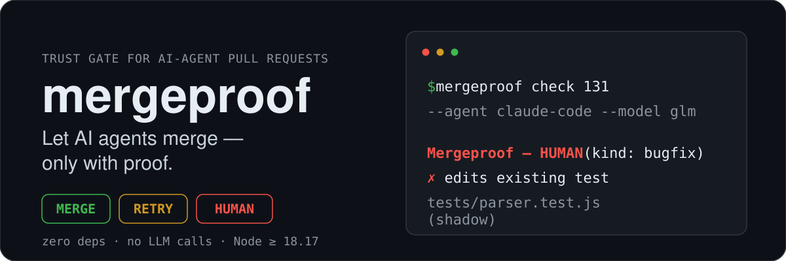
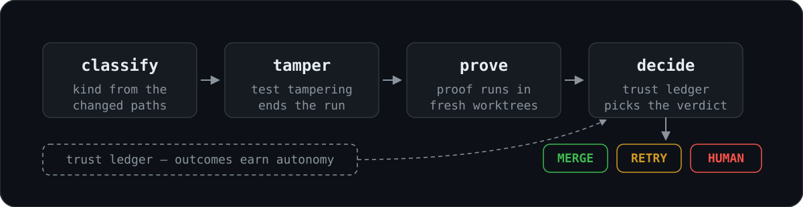

<p align="center">
  
</p>

<p align="center">
  <a href="https://github.com/ahmed-3m/mergeproof/actions/workflows/ci.yml"></a>
  <a href="https://www.npmjs.com/package/@ahmed-3m/mergeproof"></a>
  <a href="./LICENSE"></a>
  
  
  
</p>

> Status: v0.1.0 — the M1 gate (`check`, `check --local`, `sync`), the check/apply CI split, and the reusable GitHub Action with workflow templates. Verified against the [pre-registered scenarios](benchmarks/specs.md). `mergeproof init` wires a repo in one command — see [Install](#install).

Coding agents (Copilot, Codex, OpenHands, Claude Code, GLM through Claude Code) can already turn an issue into a pull request. The hard part is deciding whether that PR is safe to merge without a human. `mergeproof` is a zero-dependency, LLM-free gate that makes that decision:

1. **Inspect.** Flags test tampering: edited or deleted tests, new skip markers, edits to the gate config or workflows, labels that disagree with the changed paths, oversized diffs.
2. **Prove.** Requires proof that fits the task kind. Feature and bugfix PRs need new tests that fail on base and pass on head. Refactor PRs must leave tests untouched and pass on both. Docs and deps PRs must stay within their paths.
3. **Decide and learn.** Returns `MERGE`, `RETRY` or `HUMAN`. Autonomy is earned per task kind and per agent from a ledger of past outcomes, and lost on a revert.

<p align="center">
  
</p>

| Verdict | Meaning | Exit code |
|---|---|---|
| `MERGE` | proof held and the kind is trusted — merged in `enforce` mode, reported in `shadow` | `0` |
| `RETRY` | proof was weak (e.g. the new test already passes on base) — the agent gets another attempt | `3` |
| `HUMAN` | tampering, an untrusted kind, or impossible proof — a human takes over | `4` |

Usage errors exit `2`, other errors `1`.

## Usage

A workflow calls the gate on the agent's pull request; agents preflight locally before opening one:

```bash
npx @ahmed-3m/mergeproof check https://github.com/you/repo/pull/42 --agent claude-code --model glm-5.2 --issue 17
npx @ahmed-3m/mergeproof check <pr-url> --head <sha> --verdict-out verdict.json   # read-only gate job; --head pins the commit whose CI completed. A separate write job runs:
npx @ahmed-3m/mergeproof apply verdict.json --pr <pr-url> --head <sha> --agent <name> --model <name>  # lands the verdict, labels needs-human on HUMAN
npx @ahmed-3m/mergeproof check --local      # preflight, run by agents before opening a PR
npx @ahmed-3m/mergeproof sync               # settle the ledger, record reverts
```

`--issue <n>` is the issue the agent was dispatched for: a maintainer `bug` label on it makes the PR a bugfix (otherwise a feature). Only PRs by an author listed in `agents.logins` in `.mergeproof.json`, on a branch matching `agents.branchPrefixes`, are gated — anyone can name a branch `agent/...`, and fork PRs always go to a human.

```text
Mergeproof — HUMAN (kind: bugfix)
  ✗ edits existing test tests/parser.test.js
  (shadow)
```

Configure it with an optional `.mergeproof.json` in the repo root (read from the base branch, never the PR); see [docs/architecture.md](docs/architecture.md#config-mergeproofjson). New installs run in `shadow` mode: verdicts are reported, nothing is merged.

## Install

```bash
read -rs MERGEPROOF_MODEL_KEY && export MERGEPROOF_MODEL_KEY   # optional: when set, init stores it as a repo secret
read -rs MERGEPROOF_BOT_TOKEN && export MERGEPROOF_BOT_TOKEN   # optional: same (read -s keeps both out of shell history)
npx @ahmed-3m/mergeproof init --model <m> --bot-login <bot>
```

`init` runs inside your repository (a git repo with a `pull_request` CI workflow and a `scripts.test`). It detects the install command from the lockfile, the test command, the test paths and the CI workflow, then writes `.mergeproof.json` (always `mode: shadow`), the three workflow templates from [`templates/workflows/`](templates/README.md) with their placeholders filled, and the bugfix and feature skills under `.mergeproof/skills/`. Existing files are never silently replaced (use `--force`), `--dry-run` prints the full plan without writing, and re-runs are idempotent.

It also creates the `agent` and `needs-human` labels, sets the `MERGEPROOF_AGENT`, `MERGEPROOF_MODEL`, `MERGEPROOF_BOT_LOGIN` (and, for `glm-*` models, `MERGEPROOF_MODEL_BASE_URL`) repository variables, and pushes `MERGEPROOF_MODEL_KEY` / `MERGEPROOF_BOT_TOKEN` as secrets — their values are read from the environment variables of the same name and travel to `gh secret set` on stdin, never in argv or logs; when unset, init prints the exact `gh secret set` command to run yourself. Remote changes need `--yes` (or an interactive `y`); every run finishes with a read-only verification of branch protection, the bot's permission and the token guidance, and never changes protection settings itself. Branch protection and rulesets on a private repo need GitHub Pro, Team or Enterprise; without them init reports those checks as `unknown`, and nothing stops the bot user from merging its own PR.

## Cold start & trust

The gate no-ops until configured: an empty `agents.logins` in `.mergeproof.json` means no PR is treated as an agent PR, so nothing is gated (and fork PRs always go to a human).

Trust is earned per task kind and per agent+model: `MERGE` requires at least `trust.minOutcomes` (default 10) settled outcomes at `trust.minCleanRate` (default 90%) clean, and any revert in the recent window drops it. Until then every proven PR gets `HUMAN` — and **human merges of proven PRs still count toward trust**, which is how a new install earns autonomy: run in `shadow` mode, let the agent open PRs, merge the good ones yourself, and after 14 days (`trust.revertWindowDays`) the outcomes settle and the gate starts merging on its own. A low-volume repo can lower `minOutcomes` in its own `.mergeproof.json` — with eyes open: fewer outcomes means weaker evidence. Never seed a real ledger from `demo/ledger.json`; those outcomes did not happen.

## GitHub Actions

This repo's [`action.yml`](action.yml) is the reusable `ahmed-3m/mergeproof@v1` composite action (`check` | `apply` | `sync`), and [`templates/workflows/`](templates/README.md) ships the three workflow templates — issue to agent PR, PR to gate + apply, nightly ledger sync. `mergeproof init` copies them into your repo and fills in `{{CI_WORKFLOW}}` and `{{INSTALL_COMMAND}}` — the placeholders, repo variables and secrets are documented in [`templates/README.md`](templates/README.md), and every job's permissions in [SECURITY.md](SECURITY.md#workflow-permissions).

## Roadmap

| Milestone | Scope | Spec |
|---|---|---|
| **M1: core CLI** | `check`, `check --local`, `sync`, config, ledger, trailer | [PROTOTYPE.md](PROTOTYPE.md) |
| **M2: autopilot package** | `mergeproof init`, reusable GitHub Action, issue → skill-guided agent → PR → gate, same-PR retries, shadow mode | [briefs/m2-autopilot.md](briefs/m2-autopilot.md) |
| v2 | GitHub App, hosted dashboard, org policies | — |

## Development

```bash
node --version   # >= 18.17
npm test         # no install step, ever: zero dependencies
```

See [AGENTS.md](AGENTS.md) for architecture and hard constraints, and [docs/architecture.md](docs/architecture.md) for the module map.

## License

MIT © ahmed-3m
